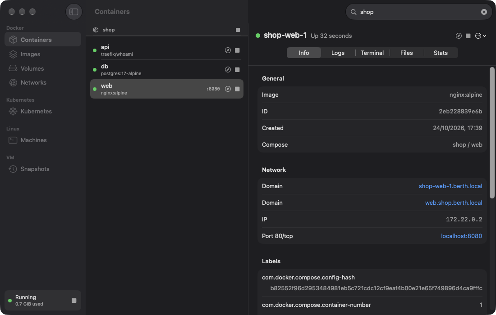
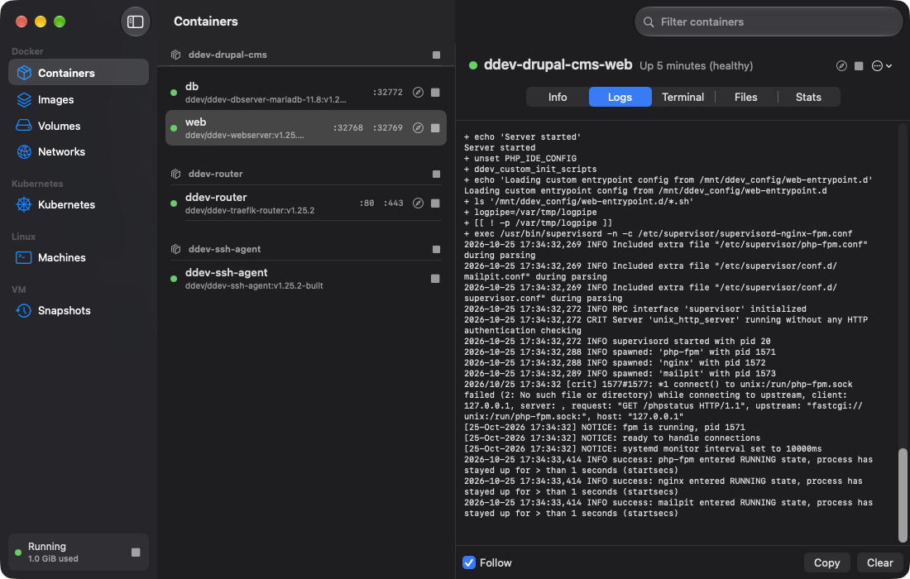
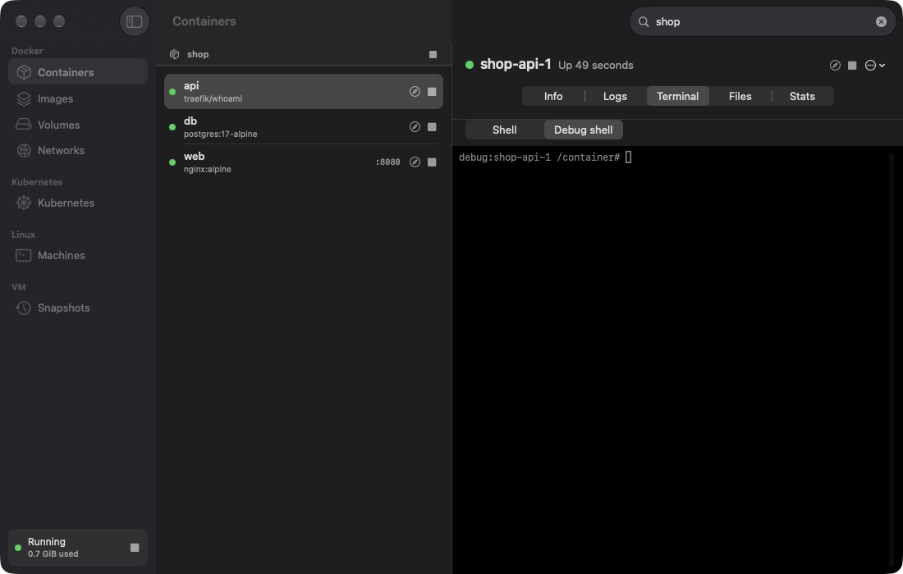
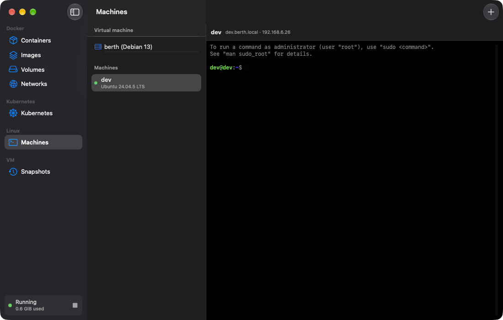
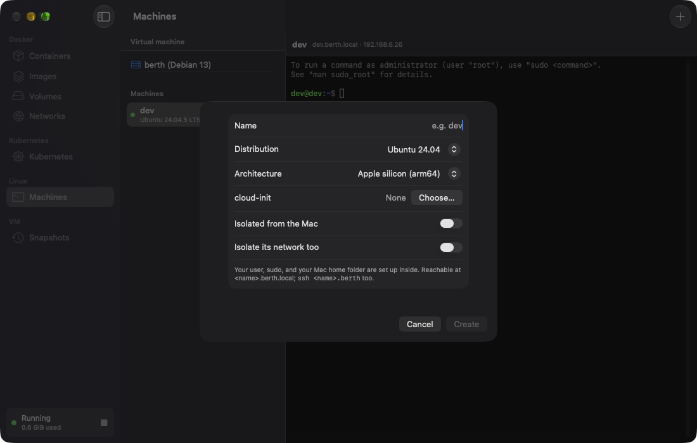
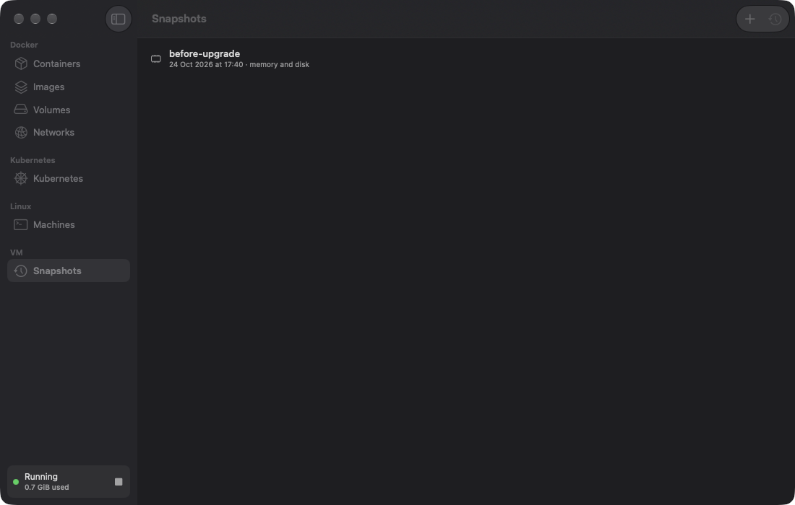
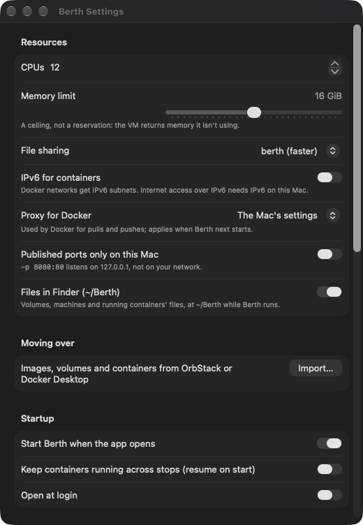

# berth

A free, open-source way to run Docker containers on Apple Silicon Macs, in the
spirit of OrbStack. Written in Rust on top of Apple's Virtualization.framework.

## Why

berth is highly inspired by DHH's talk about rewriting any app with AI and Rust.
OrbStack is a great piece of software, but it's closed source, so I wanted to see
how far an open-source take on the same idea could go: built with AI assistance,
written in Rust, and matching OrbStack's behavior from the outside rather than
from its code.

## Quick start

You need an Apple Silicon Mac, Xcode and rustup (see [Requirements](#requirements)).

**1. Build and open the app**

```sh
brew install rustup && rustup default stable
rustup target add aarch64-unknown-linux-musl
./scripts/build-app.sh
open target/Berth.app            # or copy it to /Applications first
```

On first launch, Berth walks you through setup. One administrator prompt
installs the route helper and links the `berth` CLI into `/usr/local/bin`. You
can also trust the local HTTPS certificate there. Then click **Start**, or run
`berth start`. The first start downloads Debian and installs Docker, which
takes a few minutes. Later starts take seconds.

**2. Run containers**

```sh
docker context use berth                 # berth's own context; OrbStack/Docker Desktop are untouched
docker run -d --name web -p 8080:80 nginx
curl localhost:8080                      # published ports are on the Mac's localhost
curl http://web.berth.local              # every container has a domain, no ports needed
```

Compose projects get `<service>.<project>.berth.local`. For example, `web` in
project `shop` is at `http://web.shop.berth.local`. With `berth tls trust`, the
same names work over `https://`.

**3. Look inside**

```sh
berth debug web     # a shell with tools inside the container, even a distroless one
berth open web      # the container's files in Finder (everything is under ~/Berth)
```

**4. A Linux machine**

```sh
berth machine create dev    # Ubuntu; --distro debian:trixie, fedora:44, ...; --arch amd64 for Intel
ssh dev.berth               # or: berth machine shell dev
```

Inside, your Mac home folder is mounted and `mac <command>` runs a command on
the Mac. Use `--isolated` for a machine that can't see the Mac at all.

**5. Moving over and safety nets**

```sh
berth import orbstack                   # or docker-desktop: images, volumes, networks, containers
berth snapshot create before-upgrade    # the whole VM, instantly; berth snapshot restore before-upgrade
berth config set memory_mib 8192        # settings (also in the app); berth restart applies them
```

## Features

**Engine**
- Debian 13 VM on Virtualization.framework, booted straight into berth's own
  tuned kernel (Linux 7.2 with what the VM needs built in, no initrd, and
  compressed swap in RAM; `guest/kernel`), or the VM's Debian kernel: the
  whole boot takes ~2.3 s
- Optionally (Settings, or `"stop": "suspend"` in `~/.berth/config.json`, or
  `berth stop --suspend`) `berth stop` saves the VM's state (while the Mac is
  unlocked) and the next `berth start` resumes it in ~2.7 s with every
  container still running; by default it shuts down, like OrbStack
- Docker's own engine (docker-ce 29) with the Docker API at `~/.berth/run/docker.sock`,
  `/var/run/docker.sock` (via the helper) and a `berth` docker context made current on start
- Moving over: `berth import orbstack` (or `docker-desktop`) copies images,
  volumes (contents, owners and modes), networks and containers from the other
  engine while it runs, and changes nothing there. Containers arrive stopped,
  with their Compose labels, so `docker compose up -d` picks them up.
  `--project <name>` imports one Compose project; `--dry-run` lists what would
  come over; `--images`/`--volumes`/`--containers` pick parts
- Official `docker`, Compose, Buildx and `kubectl` CLIs in `~/.berth/bin`, linked
  wherever none work, so berth doesn't depend on another Docker app
- x86-64 images through Rosetta
- Memory balloon steered by guest usage and memory-pressure events: the VM can
  use what it needs but doesn't hoard. (Virtualization.framework doesn't hand
  already-used pages back to macOS; see "Limits".)
- ASIF disk image on macOS 26+: deleting images and containers frees disk space
  on the Mac. VM data is excluded from Time Machine.

- **Alternative engines** next to Docker: `berth engine enable podman` (Debian's
  Podman 5, API at `~/.berth/run/podman.sock`, the macOS `podman` client with a
  default `berth` connection) and `berth engine enable nerdctl` (nerdctl + BuildKit
  on the containerd Docker already runs, in its own namespace; `nerdctl` on the Mac
  runs it in the VM from your current directory). Containers from every engine get
  published ports, domains, container IPs and `host.docker.internal`.

**Networking**
- Published ports (`-p 8080:80`, TCP and UDP) on the Mac, IPv4 and IPv6, following
  Docker's bind address
- Host networking: servers in `--net host` containers are on the Mac's
  `localhost` at the port they open, no `-p` needed (loopback-only servers stay
  loopback-only on the Mac)
- IPv6 for containers, opt-in (`"ipv6": true` in `~/.berth/config.json`, or
  Settings): Docker networks get IPv6 subnets, NAT'd out of the VM. Reaching the
  internet over IPv6 needs IPv6 on the Mac; without it, IPv6 works between
  containers, the VM and the Mac
- Published ports follow Docker's bind address (`-p 8080:80` is on the LAN, as with
  Docker); `"ports": "localhost"` keeps them on the Mac
- Docker pulls and pushes trust the CA certificates the Mac trusts (a company
  root, a TLS-inspecting proxy, a private registry), and use the Mac's proxy settings (`"proxy"`: auto, none or a URL;
  a change applies at the next start)
- Container domains with no setup: `<container>.berth.local`,
  `<service>.<project>.berth.local` for Compose, any subdomain, plus custom names
  from the `dev.berth.domains` (or `dev.orbstack.domains`) label; `berth domains`
  lists them. Every port and protocol works on a domain, no publishing needed.
- `http://` and `https://<name>.berth.local` without port numbers: the web port is
  detected (override: `dev.berth.http-port`), HTTPS uses a local CA limited to
  `.local` names (`berth tls trust`, or the app's setup)
- Direct container IPs from the Mac (`curl 172.17.0.2`) for every bridge network
- `host.docker.internal` reaches the Mac, including localhost-only servers
  (on macOS 27 over berth's own tunnel device: ~21 Gbit/s Mac to container,
  ~18-28 back);
  containers use the Mac's DNS, so VPN and split DNS apply

**Development**
- Bind mounts from your home folder, external drives (`/Volumes`), `/tmp` and
  `$TMPDIR` (`/var/folders`, what testcontainers uses), at the same paths, served
  by berth's own
  file sharing on macOS 27 (Apple's virtiofs before): 3x faster than Apple's on
  small files and close to OrbStack (20k files extracted in 2.4-2.7 s; OrbStack
  2.3 s, Apple's 7.9 s; reading them back is still 2.4x slower), real file
  ownership in containers, and file change
  notifications forwarded so hot reload works (`docs/file-sharing.md`)
- Kubernetes: `berth k8s enable` gives a single-node k3s using berth's Docker, so
  locally built images run in pods without a registry; `berth` kubectl context,
  API on `localhost:6443`, pod and service IPs reachable from the Mac, and
  every service by name: `curl http://web.default.svc.cluster.local`, and
  LoadBalancer services on the Mac's `localhost:<port>`
- Linux machines: `berth machine create dev --distro ubuntu:noble` (Debian,
  Fedora, Alpine, Arch, Rocky, Alma, openSUSE…) with your user, sudo, your Mac
  home, systemd, and `dev.berth.local`; `berth machine shell dev`
  - Isolated machines: `--isolated` gives them none of the Mac (no home folder,
    `mac` command or SSH agent), `--mount <folder>` shares only what you pick, and
    `--isolate-network` also keeps them off the Mac, the LAN and private networks
    (DNS and the internet only): for untrusted code and AI agents
  - `berth machine restart|rename|info|logs`, and `push`/`pull` to copy files in
    and out
  - Intel machines: `--arch amd64` runs an x86-64 distro on Rosetta
  - cloud-init: `--cloud-init user-data.yaml` applies it on first boot
    (packages, files, users, `runcmd`)
  - `ssh dev.berth` (and VS Code's Remote-SSH, which uses it): berth adds
    `Include ~/.berth/ssh/config` to `~/.ssh/config` and sets up sshd in the
    machine on first use, starting the machine if it's stopped
  - `mac <command>` inside a machine runs it on the Mac (`mac open .`,
    `mac pbcopy < file`), in the same folder when it's under your home
  - the Mac's SSH agent works in machines (`SSH_AUTH_SOCK`), and in
    containers that mount `/run/host-services/ssh-auth.sock`, as with Docker
    Desktop: `-v /run/host-services/ssh-auth.sock:/agent.sock -e SSH_AUTH_SOCK=/agent.sock`
- Files in Finder: `~/Berth/volumes` (Docker volumes), `~/Berth/machines`
  (machines' root folders) and `~/Berth/containers` (running containers' root
  filesystems), mounted over SMB from the VM while berth runs, with a password only
  you can read. Files show as yours and open as root in the VM, so anything there
  can be read and edited (`"finder": false` turns it off)
- Debug shell: `berth debug <container>` opens a root shell inside any
  container, distroless and scratch images included, with the VM's tools
  (bash, ps, ss, curl, `apt install` for more). It shares the container's
  network, processes and hostname; its files are at `/container`. Nothing is
  added to the container, and what you install is gone when the shell ends

**Snapshots**
- `berth snapshot create <name>` saves the whole VM (containers, images, volumes,
  machines, Kubernetes) in about a second: the disk is an APFS copy-on-write clone,
  so a snapshot only takes space as the VM changes afterwards
- While the Mac is unlocked it also saves memory, so `berth snapshot restore <name>`
  brings back running processes exactly where they were (databases included).
  Otherwise, or if macOS can't resume the state, it boots the snapshot's disk and
  restarts the containers that were running
- Files on the Mac (bind mounts) aren't part of a snapshot. Also in the app
  (Snapshots)

**App**: Berth.app (SwiftUI) with first-run setup, a menu-bar item, containers,
images, volumes, networks, Kubernetes, machines, terminals, logs, files and stats.

**Limits** (measured against OrbStack 2.2.5 in `bench/results/`)
- Before macOS 27 (Apple's virtiofs), small-file I/O on bind mounts is ~3.5x
  slower than OrbStack, and DDEV's `composer create-project` fails (the project
  folder shows as root-owned in containers).
- On berth's own share, Composer-heavy work is still ~1.4x slower than OrbStack
  (DDEV Drupal CMS `composer install` ~9 s vs 6.6 s, `drush site:install` 40-46 s
  vs 37 s); page loads are on par
  (`bench/results/2026-10-23-ddev-drupal.md`).
- Memory used by a workload isn't returned to macOS after it ends (OrbStack in the
  same test didn't return it within 2 minutes either).
- Deleting a folder on the Mac raises IN_DELETE in containers for the folder
  only, not for each file in it (on Linux every file gets one). Files deleted
  or renamed on the Mac do raise IN_DELETE (berth's own share).
- Anything in the VM can reach servers listening only on the Mac's loopback,
  through `host.docker.internal` (as with OrbStack), including the forwarded
  Kubernetes API on 6443.

## Requirements

An Apple Silicon Mac. berth is developed and tested on macOS 27; berth's own
file sharing and the fast `host.docker.internal` tunnel need macOS 27's
custom Virtio devices, and ASIF disks need macOS 26. On older versions berth
falls back to Apple's virtiofs and vsock. The app needs macOS 14 or later.

## Build

```sh
brew install rustup && rustup default stable
rustup target add aarch64-unknown-linux-musl   # for the guest agent
./scripts/build.sh        # builds the agent, then builds and ad-hoc signs target/release/berth
```

If `cargo` isn't found, put the toolchain on your `PATH`
(`export PATH=~/.rustup/toolchains/stable-aarch64-apple-darwin/bin:$PATH`).
The binary needs the `com.apple.security.virtualization` entitlement, which the
script adds. `cargo run -- <args>` also signs before running.

The app (needs Xcode):

```sh
./scripts/build-app.sh    # builds everything into target/Berth.app
open target/Berth.app     # or copy it to /Applications
```

## The app

Berth.app embeds the `berth` CLI (`Contents/Helpers/berth`) and talks to the
daemon's control socket and Docker's API over unix sockets; it adds no services of
its own. Closing the window keeps it in the menu bar.

- **Menu bar**: status, start/stop, running containers with start/stop and open-in-browser
- **Containers**: grouped by Compose project; start/stop/restart/delete, open in
  browser, copy domain/IP. Per container:
  - **Info**: image, domain, IPs, published ports, labels
  - **Logs**: live, follow mode
  - **Terminal**: interactive shell over Docker's exec API (bash if present, else sh),
    or the debug shell (the VM's tools, for images without a shell)
  - **Files**: browse, view and download files
  - **Stats**: live CPU and memory charts
- **Images** (with pull and progress), **Volumes**, **Networks** (subnets, container
  counts, IP routing status)
- **Kubernetes**: enable/disable, pods
- **Machines**: create (distro, Intel, cloud-init, isolation and its folders), start,
  stop, restart, rename, delete, info, logs and Open in Finder; a terminal in each,
  and a shell in the VM
- **Snapshots**: create, restore and delete
- **Settings**: CPUs, memory, file sharing, IPv6 for containers, Docker's proxy,
  volumes and machines in Finder, Podman and nerdctl, and whether stopping keeps
  containers running (suspend), merged into `~/.berth/config.json` and applied on
  restart (`docs/configuration.md`); start on app launch, open at login, install the
  IP route helper, trust the HTTPS certificate, and import from OrbStack or Docker
  Desktop. New machines can be Intel (Rosetta) and take a cloud-init file

### In pictures

Containers are grouped by Compose project. Each one shows its domains, IP and
ports. The ports and domains are links.



Logs follow live. Terminal opens a shell in the container. Debug shell works
even in images that have no shell of their own, because it brings the VM's
tools with it.




Machines are full Linux systems that share the VM. Each has a terminal,
`<name>.berth.local` and `ssh <name>.berth`. New machines can be Intel
(Rosetta), take a cloud-init file, or be isolated from the Mac.




A snapshot saves the whole VM, optionally with its running processes. Restoring
one takes everything back to that moment.



Settings cover resources, file sharing, the proxy, ports, Finder, importing
from OrbStack or Docker Desktop, and startup. They are saved to
`~/.berth/config.json`.



Launch arguments pick the starting screen, e.g.
`open target/Berth.app --args -openSection Images`,
`--args -openContainer web -openTab Logs` (or `-openTab Debug` for the debug shell),
`--args -openSettings YES` (with `-openSheet Import`), or
`--args -openSection Machines -openMachine dev -openSheet MachineInfo` (also
`MachineLogs`, `NewMachine`). `-filter shop` starts with the list filtered.

## Use

```sh
berth start               # first start downloads Debian and installs Docker (a few minutes)
docker context use berth  # or: docker --context berth ps
berth status              # exits 1 when stopped; berth info: versions, settings, paths
berth open web            # a container's (or machine's, volume's) files in Finder; berth open: ~/Berth
berth restart             # stop (shutting down) and start: applies settings
berth logs -f             # daemon log; also: berth logs console|helper
berth completions zsh > ~/.zfunc/_berth   # or bash, fish
berth domains             # container names and addresses
berth tls trust           # trust the local CA for https://*.berth.local (one-time, asks for password)
berth k8s enable          # Kubernetes (k3s) with a `berth` kubectl context
berth engine enable podman   # or nerdctl; berth engine status
berth machine create dev  # an Ubuntu machine; then: berth machine shell dev
berth config set memory_mib 8192   # settings; berth config list
berth snapshot create before-migration   # then break things...
berth snapshot restore before-migration  # ...and go back; also: list, delete
                                         # (create --disk-only, restore --yes)
berth import orbstack     # or docker-desktop: images, volumes, networks, containers
berth debug web           # a shell with tools inside container `web`, even a distroless one
berth shell               # SSH into the VM; `berth shell uname -a` runs a command
berth nerdctl ps          # nerdctl in the VM (with `berth engine enable nerdctl`)
berth tls status          # also: berth k8s status|disable, berth engine disable <name>
berth machine list        # also: start, stop, restart, delete, shell, info, logs, rename <name>
berth machine create box --isolated --mount ~/project --isolate-network
berth machine push box ./data.csv         # and: berth machine pull box /tmp/out.txt
berth stop                # --suspend: save the VM so the next start resumes it
berth delete --yes        # wipe the VM disk (containers, images, volumes)
```

### Direct container IPs (optional, one-time sudo)

Reaching container IPs needs a route on the Mac for each Docker subnet, and
routes need root. A small helper does only that:

```sh
sudo berth helper install     # run in a terminal; asks for your password
sudo berth helper uninstall   # removes it and its routes
```

It copies `berth` to a root-owned `/Library/PrivilegedHelperTools/dev.berth.helper`
and runs it as a LaunchDaemon on `/var/run/dev.berth.helper.sock`, which only your
user can use. It accepts only private subnets (10/8, 172.16/12, 192.168/16,
100.64/10, 198.18/15) pointing at a VM bridge interface, and refuses any subnet that
overlaps a network the Mac already routes. Routes follow Docker networks as they
are created and removed, and are withdrawn when berth stops. `berth status` shows
the state on the `IPs:` line; the helper logs to `/var/log/dev.berth.helper.log`.

berth keeps its own data in `~/.berth` and its own Docker context, so it runs
alongside OrbStack or Docker Desktop without touching them.

## How it works

```
docker CLI ── ~/.berth/run/docker.sock ─┐
ssh       ── ~/.berth/run/ssh.sock ────┼─ berth daemon ══ vsock:2400 ══ berth-agent ─┬─ /run/docker.sock
browser   ── localhost:<published> ────┘   (Rust, VZ)                   (Rust, guest) ├─ sshd
                                                                                      └─ 127.0.0.1:<published>
```

Every connection into the guest goes through one vsock port. The host sends a
one-line header (`unix /run/docker.sock` or `tcp 127.0.0.1:8080`) and the agent
connects there and splices bytes. The daemon follows Docker's event stream to
open and close host listeners as containers with published ports start and stop.

Host-network containers publish nothing, so the agent watches the guest's own
socket tables (`/proc/net/tcp*`, `udp*`) every 2 s and keeps the listening
sockets owned by processes in a container cgroup (`docker-<id>.scope` and the
like), which leaves out sshd, dockerd, k3s and the agent itself. When that set
changes it asks the daemon to re-sync (a `sync` header on vsock 2401), and the
daemon forwards those ports like published ones, but only on the Mac's
loopback: all-interface servers through the guest's NAT address, loopback
servers through the agent.

Domain names work differently, without the host daemon in the data path:

```
curl web.berth.local ── mDNS query on every interface ──> berth-agent answers 192.168.64.229
        └─ TCP to 192.168.64.229 ── VM NAT network ──> guest owns .229 ── DNAT ──> web (172.17.0.2)
```

macOS resolves every `.local` name with multicast DNS, including on the VM's
network interface, so the agent's responder needs no resolver file. The agent
assigns each container a service IP from the top quarter of the VM's NAT subnet
(the DHCP server allocates from the bottom), adds it to the guest's interface,
and DNATs it to the container with iptables. Addresses are a hash of the container
name, so they stay stable across restarts. When a container stops, the agent
removes the address and sends an mDNS goodbye so the Mac drops the cached name.

`host.docker.internal` runs the other way, guest to Mac:

```
container ── DNS 198.19.248.253 (agent) ── host.docker.internal = 198.19.248.254
container ── TCP 198.19.248.254:3000 ── iptables REDIRECT ── agent ══ tunnel device ══ berth daemon ── 127.0.0.1:3000 (or [::1])
```

The agent sets Docker's `dns` to its own server (keeping any other `daemon.json`
settings) and relays names it doesn't own to the guest's resolver, which forwards
to the Mac. The daemon only ever connects to the Mac's loopback, on the port the
container asked for.

On macOS 27 the connection crosses a second berth virtio-fs device,
`berth-tunnel` (`src/fuse/tunnel.rs`, `agent/src/tunnel.rs`): each connection is
a pair of FUSE stream files in it, one per direction. Apple's vsock device
moves at most ~6 Gbit/s from the Mac into the VM; the tunnel does ~21 Gbit/s.
Without it (older macOS, Apple's share), connections go over vsock port 2401.

Web access to domains goes through the agent and, for HTTPS, the host:

```
http://web.berth.local  ── service IP:80  ── REDIRECT ── agent: detect web port ── container:3000
https://web.berth.local ── service IP:443 ── REDIRECT ── agent ══ vsock ══ daemon: TLS ══ agent ── container:3000
```

The agent finds the web port from the container's listening sockets
(`/proc/<pid>/net/tcp*`, skipping loopback-only ones), probes them with an HTTP
request, and caches the answer until the container restarts. The daemon holds
berth's CA (`~/.berth/tls`) and issues a 30-day certificate per name on first use.
The CA carries an X.509 name constraint permitting only `.local`, and the daemon
refuses any other name, so trusting it cannot be abused for real sites.

- `src/vm.rs`: VM configuration (direct kernel boot, or EFI the first time, virtio disk, NAT, virtiofs, Rosetta, vsock,
  balloon) and helpers that run calls on the main dispatch queue, where the VM lives
- `src/daemon.rs`: background process; control socket, socket bridges, shutdown
- `src/ports.rs`: published-port forwarding driven by Docker events
- `src/routes.rs`, `src/helper.rs`: container subnet routes and the root helper
- `src/virtiofs.rs`, `src/fuse.rs` (+ `fuse/nofollow.rs`): berth's file sharing
  device and FUSE server; `guest/kmod/virtiofs_poll`: its polling guest driver,
  built in the VM by `agent/src/kmod.rs`
- `src/fuse/tunnel.rs` (agent: `tunnel.rs`): the `host.docker.internal` tunnel device
- `src/watch.rs`: FSEvents → inotify forwarding for bind mounts
- `src/memory.rs`: balloon controller
- `src/k8s.rs`, `src/machines.rs`: Kubernetes and Linux machines (agent: `k8s.rs`, `machines.rs`)
- `src/cli_tools.rs`: bundled Docker/Compose/Buildx/kubectl CLIs
- `src/engines.rs` (agent: `engines.rs`): Podman and nerdctl
- `agent/`: the guest agent, a static Linux binary embedded in `berth` and
  refreshed into `~/.berth/guest/` on every start
  - `domains.rs`: Docker watcher, service IPs, guest addresses and NAT
  - `mdns.rs`: multicast DNS responder
  - `dns.rs`: DNS server for containers
  - `hostnet.rs`: `host.docker.internal` forwarding to the Mac
  - `listeners.rs`: host-network containers' listening ports
  - `ipv6.rs`: the IPv6 setting (Docker's IPv6 options, router advertisements)
  - `web.rs`: web port detection, HTTP/HTTPS entry for domains
- `src/snapshots.rs`: VM snapshots and suspend (disk clones, saved machine state, restore)
- `src/macexec.rs` (agent: `mac.rs`), `src/sshconfig.rs`: machines and the Mac: the `mac`
  command, the SSH agent, `ssh <machine>.berth`
- `src/files.rs` (agent: `files.rs`): `~/Berth` in Finder over SMB
- `guest/berth-debug.sh`: `berth debug`
- `src/import.rs`: `berth import` from OrbStack or Docker Desktop
- `src/cacerts.rs` (+ `guest/berth-ca-sync.sh`): the Mac's trusted CAs for the VM
- `src/dockerapi.rs`: the Docker socket bridge (maps `/tmp`, `/var/folders` bind sources);
  agent `shares.rs` mounts `/Volumes`, `/private/tmp`, `/private/var/folders`
- `src/config.rs`: `berth config`; `src/proxy.rs` (agent: `proxy.rs`): Docker's proxy
- `src/paths.rs`: the `~/.berth` layout
- agent `inroot.rs`: files inside a machine opened as the machine sees them (its
  symlinks can't point the VM's root elsewhere)
- `src/context.rs`: the `berth` docker context
- agent: `boot.rs` (direct boot, kernel export), `docker.rs` (Docker API client),
  `engine.rs` (docker-ce install), `memory.rs` (balloon, memory pressure),
  `kmod.rs` (the polling driver's build), `tunnel.rs`, `mac.rs`, `files.rs`
- `src/tls.rs`: the local CA, per-name certificates, keychain trust
- `src/provision.rs`: image download and checksum, disk clone, SSH key, cloud-init seed
- `guest/user-data.yaml`: guest provisioning (Docker, mounts, Rosetta binfmt, agent unit)
- `app/`: the SwiftUI app (SwiftTerm for terminals, Swift Charts for stats)

Logs are in `~/.berth/log/` (`daemon.log`, `console.log`); the helper's is
`/var/log/dev.berth.helper.log`. `berth logs [-f] [console|helper]` shows them.

## Roadmap

Informed by OrbStack users' most-requested features (public issue tracker and
discussions) and the limits above:

- **File sharing**: close the remaining Composer gap (fewer round trips per
  file); push invalidations to the guest instead of relying on FSEvents
  touches; prebuilt guest modules, so the polling driver needs no download
- **Machines**: custom images; per-machine and per-volume snapshots
  next to the whole-VM ones
- **Linux GUI apps**: first a console window (virtio-gpu 2D, clipboard via
  spice-vdagent), then per-app windows like WSLg (a compositor in the machine,
  surfaces streamed to native windows). Rendering is CPU-only until there's GPU
  acceleration: macOS 27's custom Virtio devices with shared memory may allow a
  virtio-gpu (Venus → MoltenVK/KosmicKrisp) while keeping Rosetta; unproven.
- **Games (experimental, later)**: Steam/Proton needs Vulkan and 32-bit x86
  (FEX alongside Rosetta), so it depends on the GPU work above; for Windows games
  today, CrossOver/Game Porting Toolkit is the better path
- **Networking**: bridged mode (container IPs on the LAN) through the root helper,
  `.berth.local` names reachable from other devices, client source IP preservation
- **Memory**: returning freed memory to macOS needs a VMM with free-page reporting
  (Hypervisor.framework / libkrun); worth it only if it keeps Rosetta working
- **Distribution**: auto-update (releases are signed and notarized once a
  Developer ID is configured, see CONTRIBUTING); data location setting

## Documentation

- `docs/configuration.md`: `~/.berth/config.json`, suspend, environment variables, files
- `docs/troubleshooting.md`: common problems, starting over, uninstalling
- `docs/file-sharing.md`: berth's own file sharing and its polling guest driver
- `docs/LEARNINGS.md`: platform quirks, measurements and dead ends found so far
- `docs/KNOWN_ISSUES.md`: open review findings
- `CONTRIBUTING.md`: setting up, the clean-room rule, layout, testing
- `CHANGELOG.md`: what changed
- `bench/results/`: benchmark runs against OrbStack

## License

MIT (`LICENSE`), except the guest kernel module in `guest/kmod/`, which is
derived from Linux and is GPL-2.0.

## Compatibility notes

berth matches OrbStack's documented and externally observable behavior. It
contains no OrbStack code: it was written from OrbStack's public documentation and
by observing a running install from the outside (names it answers, addresses,
routes). Where OrbStack relies on a macOS entitlement Apple grants only to approved
developers (its per-network vmnet interfaces), berth uses a root route helper instead. OrbStack is a trademark of its owner; berth is not affiliated with it.
